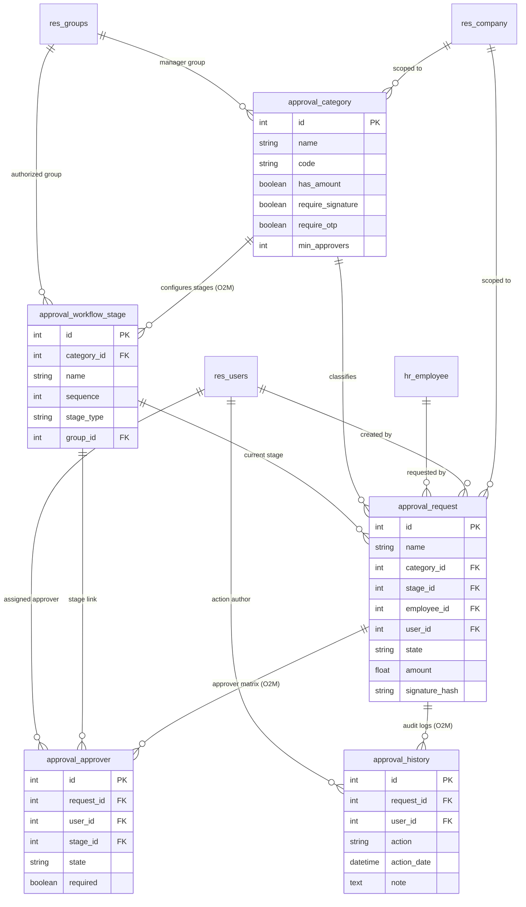
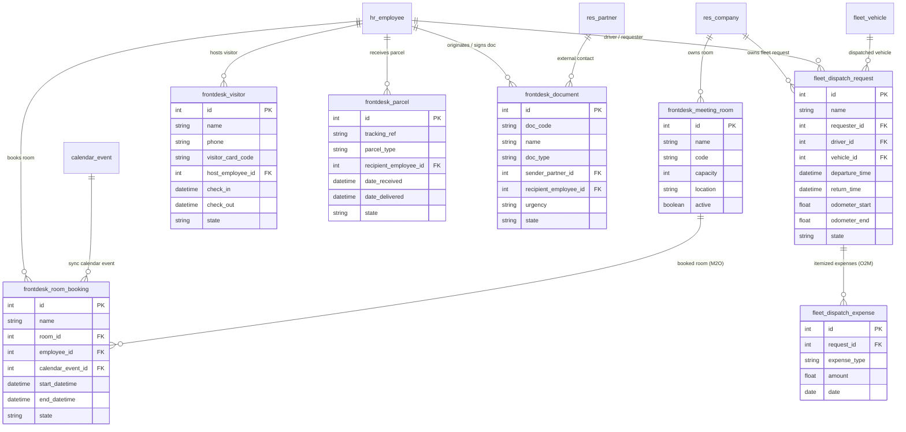
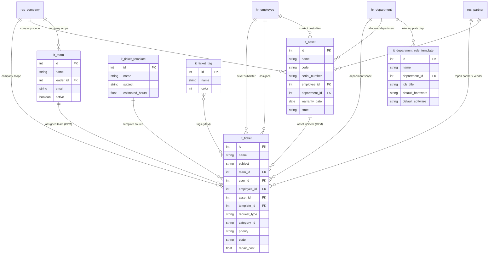
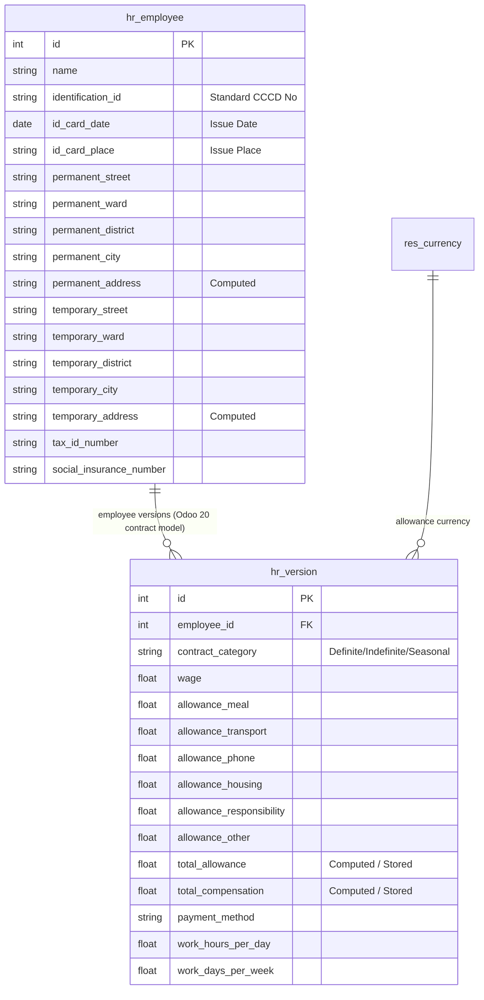
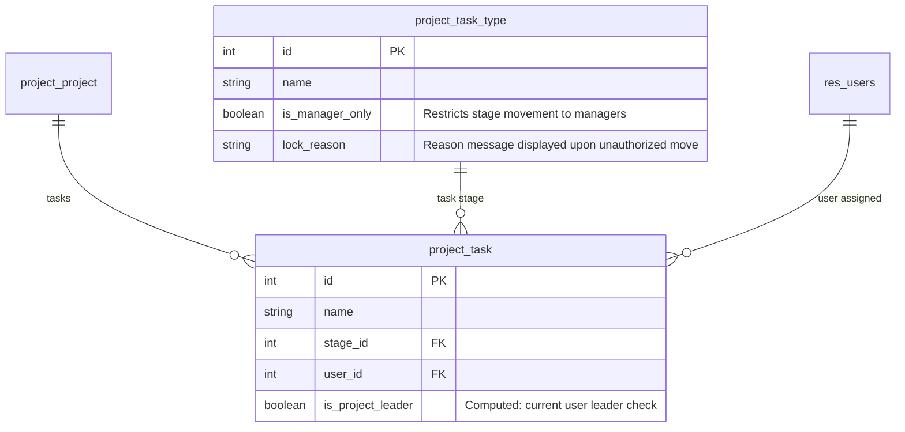

# Data Relations Schema & Architecture ERD

> **Specification & Data Audit Reference**
> Scope: Custom Addons under `./custom_addons` | Odoo Version: 20.0 Community
> Generated: Automated Static AST & Model Registry Analysis

---

## 1. Executive Summary

This document delivers an exhaustive technical audit of the complete data architecture, model inheritance hierarchy, relational topology, and database schemas across all custom modules located in `./custom_addons`.

### Key System Metrics

| Metric Category | Count | Details |
| :--- | :--- | :--- |
| **Custom Modules Surveyed** | `17` | 7 Primary Addons + 10 Theme/UI Addons under `themes/` |
| **Total Model Classes Analyzed** | `49` | Python classes inheriting from `models.Model`, `TransientModel`, or `AbstractModel` |
| **New Custom Business Tables (`_name`)** | `19` | Dedicated PostgreSQL physical tables created in the database |
| **Core Model Extensions (`_inherit`)** | `13` | Standard Odoo models extended with custom fields and business logic |
| **Transient / Wizard Models** | `7` | Interactive dialogs, signature OTP validation, and settings wizards |
| **Abstract / Report Models** | `10` | QWeb dynamic print parser engines and theme asset editors |
| **Total Fields Defined** | `313` | Declared business, technical, computed, and relational columns |
| **Relational Links (M2O, O2M, M2M)** | `73` | 60 Many2one, 6 One2many, 7 Many2many relationships |
| **Relational Integrity Audit** | **100% Valid** | **0 Broken Inverses**, **0 Orphaned Pointers**, verified co-model match |

### Field Types Distribution

| Field Type | Count | % of Total | Primary Use Case |
| :--- | :--- | :--- | :--- |
| `Char` | 77 | 24.6% | Scalar / Attribute storage |
| `Many2one` | 60 | 19.2% | Relational connection |
| `Selection` | 38 | 12.1% | Scalar / Attribute storage |
| `Boolean` | 27 | 8.6% | Scalar / Attribute storage |
| `Integer` | 22 | 7.0% | Scalar / Attribute storage |
| `Datetime` | 18 | 5.8% | Scalar / Attribute storage |
| `Text` | 15 | 4.8% | Scalar / Attribute storage |
| `Monetary` | 11 | 3.5% | Scalar / Attribute storage |
| `Date` | 9 | 2.9% | Scalar / Attribute storage |
| `Float` | 9 | 2.9% | Scalar / Attribute storage |
| `Binary` | 9 | 2.9% | Scalar / Attribute storage |
| `Many2many` | 7 | 2.2% | Relational connection |
| `One2many` | 6 | 1.9% | Relational connection |
| `Html` | 4 | 1.3% | Scalar / Attribute storage |
| `Image` | 1 | 0.3% | Scalar / Attribute storage |

---

## 2. Cross-Module Relationship & Integrity Audit

### 2.1 Relational Integrity Verification
All declared `One2many` relations across custom addons were verified against their target co-models. Every reciprocal `Many2one` inverse exists and points back to the correct source model:

| Source Model | One2many Field | Target Co-Model | Reciprocal Many2one Field | Inverted Co-Model Target | Status |
| :--- | :--- | :--- | :--- | :--- | :--- |
| `approval.category` | `stage_ids` | `approval.workflow.stage` | `category_id` | `approval.category` | Verified Active |
| `approval.request` | `approver_ids` | `approval.approver` | `request_id` | `approval.request` | Verified Active |
| `approval.request` | `history_ids` | `approval.history` | `request_id` | `approval.request` | Verified Active |
| `fleet.dispatch.request` | `expense_ids` | `fleet.dispatch.expense` | `request_id` | `fleet.dispatch.request` | Verified Active |
| `it.asset` | `ticket_ids` | `it.ticket` | `asset_id` | `it.asset` | Verified Active |
| `it.team` | `ticket_ids` | `it.ticket` | `team_id` | `it.team` | Verified Active |

### 2.2 Core Odoo Integration Targets
Custom models interface with standard Odoo core entities via the following verified connections:

| Core Target Model | Inbound Custom Fields Count | Referencing Custom Models | Functional Purpose |
| :--- | :--- | :--- | :--- |
| `res.users` | 12 | `approval.approver`, `approval.history`, `approval.request`, `frontdesk.visitor`, `frontdesk.document`, `it.ticket`, `it.team`, `res.users (muk)` | User assignment, sign-off authoring, approval actions, portal agents |
| `hr.employee` | 11 | `approval.request`, `frontdesk.visitor`, `frontdesk.parcel`, `frontdesk.document`, `frontdesk.room.booking`, `fleet.dispatch.request`, `it.ticket`, `it.asset` | Employee requester, visitor host, parcel recipient, vehicle driver, asset user |
| `res.company` | 9 | `approval.category`, `approval.request`, `frontdesk.meeting.room`, `fleet.dispatch.request`, `it.ticket`, `it.team`, `it.asset`, `it.department.role.template` | Multi-company record security, isolation, and auto-filtering |
| `res.partner` | 5 | `frontdesk.document`, `it.ticket`, `it.asset` | External senders/recipients, hardware vendors, warranty & repair contractors |
| `hr.department` | 4 | `it.ticket`, `it.asset`, `it.department.role.template` | Departmental hardware tracking and onboarding IT provisioning profiles |
| `calendar.event` | 2 | `frontdesk.room.booking` | Bi-directional synchronization with Odoo Calendar for meeting room reservations |
| `fleet.vehicle` | 1 | `fleet.dispatch.request` | Company vehicle fleet assignment and odometer tracking |
| `ir.attachment` | 2 | `approval.request`, `it.ticket` | Uploaded supporting receipts, technical logs, and evidence attachments |

---

## 3. Module Breakdown & Data Dictionary

Below is the comprehensive data catalog organized by module. For every model, all declared fields are documented with technical data type, co-model target, inverse relation, constraints, and business purpose.

### 3.1 Module: `custom_hr_contract`

- **Module Title:** Vietnamese HR Contract & Version Management
- **Directory:** `custom_addons/custom_hr_contract`
- **Category:** Human Resources
- **Declared Dependencies (`depends`):** `base`, `mail`, `hr`
- **Functional Description:** Tailored for compliance with the Vietnam Labor Code 2019. Extends `hr.employee` and `hr.version` to capture citizen identification (CCCD issue details), structured dual addresses (permanent & temporary), itemized salary allowances, and Vietnamese print templates.

#### Model: `hr.employee`
- **Python Class:** `HrEmployee` (Model)
- **File:** `custom_addons/custom_hr_contract/models/hr_employee.py`
- **Total Declared Fields:** `14`

| Model Name | Field Name | Type | Target Model (comodel) | Inverse / Relation | Required / Store | Description / Purpose |
| :--- | :--- | :--- | :--- | :--- | :--- | :--- |
| `hr.employee` | `id_card_date` | `Date` | — | — | Tracked grp:`hr.group_hr_user` | Date the Citizen ID card (CCCD) was issued. |
| `hr.employee` | `id_card_place` | `Char` | — | — | Tracked grp:`hr.group_hr_user` | Authority that issued the Citizen ID card. |
| `hr.employee` | `permanent_street` | `Char` | — | — | Tracked grp:`hr.group_hr_user` | Permanent Street |
| `hr.employee` | `permanent_ward` | `Char` | — | — | Tracked grp:`hr.group_hr_user` | Phường/Xã of the permanent address. |
| `hr.employee` | `permanent_district` | `Char` | — | — | Tracked grp:`hr.group_hr_user` | Quận/Huyện of the permanent address. |
| `hr.employee` | `permanent_city` | `Char` | — | — | Tracked grp:`hr.group_hr_user` | Tỉnh/Thành phố of the permanent address. |
| `hr.employee` | `temporary_street` | `Char` | — | — | Tracked grp:`hr.group_hr_user` | Temporary Street |
| `hr.employee` | `temporary_ward` | `Char` | — | — | Tracked grp:`hr.group_hr_user` | Phường/Xã of the temporary address. |
| `hr.employee` | `temporary_district` | `Char` | — | — | Tracked grp:`hr.group_hr_user` | Quận/Huyện of the temporary address. |
| `hr.employee` | `temporary_city` | `Char` | — | — | Tracked grp:`hr.group_hr_user` | Tỉnh/Thành phố of the temporary address. |
| `hr.employee` | `tax_id_number` | `Char` | — | — | Tracked grp:`hr.group_hr_user` | Mã số thuế thu nhập cá nhân. |
| `hr.employee` | `social_insurance_number` | `Char` | — | — | Tracked grp:`hr.group_hr_user` | Số sổ bảo hiểm xã hội. |
| `hr.employee` | `permanent_address` | `Char` | — | — | calc:`_compute_permanent_address` | Full concatenated permanent address for display/reports. |
| `hr.employee` | `temporary_address` | `Char` | — | — | calc:`_compute_temporary_address` | Full concatenated temporary address for display/reports. |

#### Model: `hr.version`
- **Python Class:** `HrVersion` (Model)
- **File:** `custom_addons/custom_hr_contract/models/hr_version.py`
- **Total Declared Fields:** `12`

| Model Name | Field Name | Type | Target Model (comodel) | Inverse / Relation | Required / Store | Description / Purpose |
| :--- | :--- | :--- | :--- | :--- | :--- | :--- |
| `hr.version` | `contract_category` | `Selection` | — | — | Tracked grp:`hr.group_hr_user` | Vietnamese labor contract category as per Labor Code 2019. (Options: definite, indefinite, seasonal) |
| `hr.version` | `allowance_meal` | `Monetary` | — | — | Tracked grp:`hr.group_hr_user` | Monthly meal allowance (Phụ cấp ăn trưa). |
| `hr.version` | `allowance_transport` | `Monetary` | — | — | Tracked grp:`hr.group_hr_user` | Monthly transport allowance (Phụ cấp đi lại). |
| `hr.version` | `allowance_phone` | `Monetary` | — | — | Tracked grp:`hr.group_hr_user` | Monthly phone allowance (Phụ cấp điện thoại). |
| `hr.version` | `allowance_housing` | `Monetary` | — | — | Tracked grp:`hr.group_hr_user` | Monthly housing allowance (Phụ cấp nhà ở). |
| `hr.version` | `allowance_responsibility` | `Monetary` | — | — | Tracked grp:`hr.group_hr_user` | Monthly responsibility allowance (Phụ cấp trách nhiệm). |
| `hr.version` | `allowance_other` | `Monetary` | — | — | Tracked grp:`hr.group_hr_user` | Other monthly allowances (Phụ cấp khác). |
| `hr.version` | `total_allowance` | `Monetary` | — | — | Store calc:`_compute_total_allowance` grp:`hr.group_hr_user` | Sum of all monthly allowances. |
| `hr.version` | `total_compensation` | `Monetary` | — | — | Store calc:`_compute_total_compensation` grp:`hr.group_hr_manager` | Wage + Total Allowances. |
| `hr.version` | `payment_method` | `Selection` | — | — | Tracked grp:`hr.group_hr_user` | Method used to pay the employee's salary. (Options: bank, cash) |
| `hr.version` | `work_hours_per_day` | `Float` | — | — | Tracked grp:`hr.group_hr_user` | Standard working hours per day. |
| `hr.version` | `work_days_per_week` | `Float` | — | — | Tracked grp:`hr.group_hr_user` | Standard working days per week. |

#### Model: `report.custom_hr_contract.report_labor_contract`
- **Python Class:** `ReportLaborContract` (AbstractModel)
- **File:** `custom_addons/custom_hr_contract/report/report_labor_contract.py`
- **Description:** Vietnamese Labor Contract Report Parser
- **Total Declared Fields:** `0`

_No new fields declared on this model class (logic extension / method override only)._

---

### 3.2 Module: `enterprise_approval`

- **Module Title:** Enterprise Multi-Stage Approval Engine
- **Directory:** `custom_addons/enterprise_approval`
- **Category:** Productivity / Approvals
- **Declared Dependencies (`depends`):** `base`, `mail`, `hr`
- **Functional Description:** Comprehensive enterprise workflow automation engine. Provides multi-tier approval categories, dynamic approver assignments, OTP/digital signature verification, audit trail logs, and PDF slip printing.

#### Model: `approval.approver`
- **Python Class:** `ApprovalApprover` (Model)
- **File:** `custom_addons/enterprise_approval/models/approval_approver.py`
- **Description:** Người phê duyệt
- **Total Declared Fields:** `8`

| Model Name | Field Name | Type | Target Model (comodel) | Inverse / Relation | Required / Store | Description / Purpose |
| :--- | :--- | :--- | :--- | :--- | :--- | :--- |
| `approval.approver` | `request_id` | `Many2one` | `approval.request` | — | **Req** | Yêu cầu phê duyệt [ondelete: cascade] |
| `approval.approver` | `user_id` | `Many2one` | `res.users` | — | **Req** | Người duyệt |
| `approval.approver` | `status` | `Selection` | — | — | Opt / Store | Trạng thái (Options: new, approved, refused, cancel) |
| `approval.approver` | `sequence` | `Integer` | — | — | Opt / Store | Thứ tự |
| `approval.approver` | `is_otp_verified` | `Boolean` | — | — | Opt / Store | Đánh dấu dòng phê duyệt đã được xác thực ký số 2FA OTP. |
| `approval.approver` | `otp_verified_email` | `Char` | — | — | Opt / Store | Địa chỉ email công vụ nhận mã xác thực OTP. |
| `approval.approver` | `signature_hash` | `Char` | — | — | Opt / Store | Mã băm mã hóa SHA-256 đảm bảo tính bất khả chối bỏ của chữ ký. |
| `approval.approver` | `signed_datetime` | `Datetime` | — | — | Opt / Store | Thời điểm thực hiện ký số điện tử (UTC). |

#### Model: `approval.category`
- **Python Class:** `ApprovalCategory` (Model)
- **File:** `custom_addons/enterprise_approval/models/approval_category.py`
- **Description:** Loại phê duyệt
- **Total Declared Fields:** `15`

| Model Name | Field Name | Type | Target Model (comodel) | Inverse / Relation | Required / Store | Description / Purpose |
| :--- | :--- | :--- | :--- | :--- | :--- | :--- |
| `approval.category` | `name` | `Char` | — | — | **Req** | Tên của danh mục yêu cầu / phê duyệt |
| `approval.category` | `code` | `Char` | — | — | **Req** | Mã viết tắt nhận diện loại phê duyệt (Ví dụ: PAYMENT, LEAVE, PROCUREMENT) |
| `approval.category` | `sequence` | `Integer` | — | — | Opt / Store | Thứ tự hiển thị |
| `approval.category` | `active` | `Boolean` | — | — | Opt / Store | Bỏ chọn để ẩn danh mục này khỏi danh sách tạo yêu cầu |
| `approval.category` | `icon` | `Char` | — | — | Opt / Store | Tên class FontAwesome (ví dụ: fa-money, fa-car, fa-plane) |
| `approval.category` | `color` | `Integer` | — | — | Opt / Store | Chỉ số màu |
| `approval.category` | `image` | `Binary` | — | — | Opt / Store | Ảnh minh họa cho loại phê duyệt này |
| `approval.category` | `description` | `Text` | — | — | Opt / Store | Hướng dẫn cho nhân viên về điều kiện và giấy tờ cần thiết khi tạo loại yêu cầu này |
| `approval.category` | `approver_id` | `Many2one` | `res.users` | — | Opt / Store | Người dùng được chỉ định phê duyệt khi không có cấu hình đặc thù |
| `approval.category` | `manager_approval` | `Boolean` | — | — | Opt / Store | Nếu bật, hệ thống sẽ tự động gán Quản lý trực tiếp của nhân viên làm người duyệt |
| `approval.category` | `has_amount` | `Selection` | — | — | **Req** | Trường Số tiền / Chi phí (Options: no, optional, required) |
| `approval.category` | `has_date` | `Selection` | — | — | **Req** | Trường Thời gian / Khoảng ngày (Options: no, optional, required) |
| `approval.category` | `has_location` | `Selection` | — | — | **Req** | Trường Địa điểm / Lộ trình (Options: no, optional, required) |
| `approval.category` | `stage_ids` | `One2many` | `approval.workflow.stage` | inv: `category_id` | Opt / Store | Các bước phê duyệt |
| `approval.category` | `request_count` | `Integer` | — | — | calc:`_compute_request_count` | Số yêu cầu |

#### Model: `approval.history`
- **Python Class:** `ApprovalHistory` (Model)
- **File:** `custom_addons/enterprise_approval/models/approval_history.py`
- **Description:** Nhật ký phê duyệt
- **Total Declared Fields:** `5`

| Model Name | Field Name | Type | Target Model (comodel) | Inverse / Relation | Required / Store | Description / Purpose |
| :--- | :--- | :--- | :--- | :--- | :--- | :--- |
| `approval.history` | `request_id` | `Many2one` | `approval.request` | — | **Req** | Yêu cầu phê duyệt [ondelete: cascade] |
| `approval.history` | `user_id` | `Many2one` | `res.users` | — | **Req** | Người thực hiện |
| `approval.history` | `action` | `Selection` | — | — | **Req** | Hành động (Options: draft, submit, approve, reject...) |
| `approval.history` | `timestamp` | `Datetime` | — | — | **Req** | Thời gian |
| `approval.history` | `comment` | `Text` | — | — | Opt / Store | Ghi chú / Phản hồi |

#### Model: `approval.request`
- **Python Class:** `ApprovalRequest` (Model)
- **File:** `custom_addons/enterprise_approval/models/approval_request.py`
- **Inherits (`_inherit`):** `mail.thread, mail.activity.mixin`
- **Description:** Yêu cầu phê duyệt
- **Total Declared Fields:** `31`

| Model Name | Field Name | Type | Target Model (comodel) | Inverse / Relation | Required / Store | Description / Purpose |
| :--- | :--- | :--- | :--- | :--- | :--- | :--- |
| `approval.request` | `name` | `Char` | — | — | Tracked | Mã yêu cầu tự động sinh theo mẫu REQ/YYYY/NNNN |
| `approval.request` | `title` | `Char` | — | — | **Req** Tracked | Tóm tắt ngắn gọn nội dung yêu cầu (ví dụ: Đi công tác Hà Nội, Tạm ứng công tác phí) |
| `approval.request` | `category_id` | `Many2one` | `approval.category` | — | **Req** Tracked | Loại yêu cầu / danh mục luồng phê duyệt |
| `approval.request` | `category_code` | `Char` | — | related: `category_id.code` | Store | Mã danh mục |
| `approval.request` | `has_amount` | `Selection` | — | related: `category_id.has_amount` | Opt / Store | Có trường số tiền |
| `approval.request` | `has_date` | `Selection` | — | related: `category_id.has_date` | Opt / Store | Có trường thời gian |
| `approval.request` | `has_location` | `Selection` | — | related: `category_id.has_location` | Opt / Store | Có trường địa điểm |
| `approval.request` | `category_image` | `Binary` | — | related: `category_id.image` | Opt / Store | Hình ảnh danh mục |
| `approval.request` | `requester_id` | `Many2one` | `res.users` | — | **Req** Tracked | Tài khoản người dùng tạo và gửi yêu cầu phê duyệt |
| `approval.request` | `employee_id` | `Many2one` | `hr.employee` | — | Store calc:`_compute_employee_info` | Hồ sơ nhân sự liên kết với người tạo yêu cầu |
| `approval.request` | `department_id` | `Many2one` | `hr.department` | — | Store calc:`_compute_employee_info` | Phòng ban của nhân viên |
| `approval.request` | `company_id` | `Many2one` | `res.company` | — | **Req** | Công ty |
| `approval.request` | `approver_id` | `Many2one` | `res.users` | — | Tracked | Người chịu trách nhiệm xem xét và phê duyệt yêu cầu này |
| `approval.request` | `approver_ids` | `One2many` | `approval.approver` | inv: `request_id` | Opt / Store | Danh sách người duyệt |
| `approval.request` | `current_stage_id` | `Many2one` | `approval.workflow.stage` | — | Tracked | Bước duyệt hiện tại |
| `approval.request` | `state` | `Selection` | — | — | **Req** Tracked | Trạng thái xử lý của yêu cầu phê duyệt (Options: draft, submitted, approved, rejected, cancelled) |
| `approval.request` | `priority` | `Selection` | — | — | Tracked | Độ ưu tiên (Options: 0, 1, 2, 3) |
| `approval.request` | `description` | `Html` | — | — | Opt / Store | Lý do chi tiết, tài liệu liên quan hoặc nội dung đề xuất |
| `approval.request` | `amount` | `Monetary` | — | — | Tracked | Số tiền |
| `approval.request` | `currency_id` | `Many2one` | `res.currency` | — | Opt / Store | Tiền tệ |
| `approval.request` | `date_start` | `Datetime` | — | — | Tracked | Thời gian bắt đầu |
| `approval.request` | `date_end` | `Datetime` | — | — | Tracked | Thời gian kết thúc |
| `approval.request` | `location` | `Char` | — | — | Tracked | Địa điểm công tác, địa chỉ giao hàng hoặc lộ trình điều xe |
| `approval.request` | `date_submitted` | `Datetime` | — | — | Opt / Store | Thời gian gửi duyệt |
| `approval.request` | `date_confirmed` | `Datetime` | — | — | Opt / Store | Thời gian xử lý |
| `approval.request` | `confirmed_by` | `Many2one` | `res.users` | — | Opt / Store | Người quyết định |
| `approval.request` | `rejection_reason` | `Text` | — | — | Tracked | Lý do từ chối |
| `approval.request` | `history_ids` | `One2many` | `approval.history` | inv: `request_id` | Opt / Store | Nhật ký phê duyệt |
| `approval.request` | `can_approve` | `Boolean` | — | — | calc:`_compute_user_permissions` | Có quyền duyệt |
| `approval.request` | `can_reject` | `Boolean` | — | — | calc:`_compute_user_permissions` | Có quyền từ chối |
| `approval.request` | `attachment_number` | `Integer` | — | — | calc:`_compute_attachment_number` | Tài liệu đính kèm |

#### Model: `approval.workflow.stage`
- **Python Class:** `ApprovalWorkflowStage` (Model)
- **File:** `custom_addons/enterprise_approval/models/approval_workflow_stage.py`
- **Description:** Bước phê duyệt
- **Total Declared Fields:** `6`

| Model Name | Field Name | Type | Target Model (comodel) | Inverse / Relation | Required / Store | Description / Purpose |
| :--- | :--- | :--- | :--- | :--- | :--- | :--- |
| `approval.workflow.stage` | `name` | `Char` | — | — | **Req** | Ví dụ: Bước 1 - Trưởng bộ phận, Bước 2 - Kế toán trưởng, Bước 3 - Ban Giám đốc |
| `approval.workflow.stage` | `sequence` | `Integer` | — | — | Opt / Store | Thứ tự |
| `approval.workflow.stage` | `category_id` | `Many2one` | `approval.category` | — | **Req** | Loại phê duyệt [ondelete: cascade] |
| `approval.workflow.stage` | `approver_id` | `Many2one` | `res.users` | — | Opt / Store | Chỉ định người dùng cụ thể phê duyệt ở bước này |
| `approval.workflow.stage` | `approver_group_id` | `Many2one` | `res.groups` | — | Opt / Store | Bất kỳ thành viên nào thuộc nhóm này đều có thể duyệt ở bước này |
| `approval.workflow.stage` | `manager_approval` | `Boolean` | — | — | Opt / Store | Tự động gán Quản lý trực tiếp của người tạo yêu cầu làm người duyệt |

#### Model: `report.enterprise_approval.report_approval_slip`
- **Python Class:** `ReportApprovalSlip` (AbstractModel)
- **File:** `custom_addons/enterprise_approval/report/report_approval_slip.py`
- **Description:** A4 Approval Slip Report
- **Total Declared Fields:** `0`

_No new fields declared on this model class (logic extension / method override only)._

#### Model: `approval.reject.wizard`
- **Python Class:** `ApprovalRejectWizard` (TransientModel)
- **File:** `custom_addons/enterprise_approval/wizards/approval_reject_wizard.py`
- **Description:** Từ chối yêu cầu phê duyệt
- **Total Declared Fields:** `2`

| Model Name | Field Name | Type | Target Model (comodel) | Inverse / Relation | Required / Store | Description / Purpose |
| :--- | :--- | :--- | :--- | :--- | :--- | :--- |
| `approval.reject.wizard` | `request_id` | `Many2one` | `approval.request` | — | **Req** | Yêu cầu phê duyệt |
| `approval.reject.wizard` | `reason` | `Text` | — | — | **Req** | Vui lòng giải thích rõ ràng lý do không phê duyệt yêu cầu này |

#### Model: `approval.signature.otp.wizard`
- **Python Class:** `ApprovalSignatureOtpWizard` (TransientModel)
- **File:** `custom_addons/enterprise_approval/wizards/approval_signature_otp_wizard.py`
- **Description:** Xác thực chữ ký số 2FA OTP
- **Total Declared Fields:** `6`

| Model Name | Field Name | Type | Target Model (comodel) | Inverse / Relation | Required / Store | Description / Purpose |
| :--- | :--- | :--- | :--- | :--- | :--- | :--- |
| `approval.signature.otp.wizard` | `request_id` | `Many2one` | `approval.request` | — | **Req** | Phiếu yêu cầu [ondelete: cascade] |
| `approval.signature.otp.wizard` | `approver_id` | `Many2one` | `approval.approver` | — | **Req** | Dòng người duyệt [ondelete: cascade] |
| `approval.signature.otp.wizard` | `otp_input` | `Char` | — | — | Opt / Store | Nhập mã xác thực gồm 6 chữ số được gửi tới email công vụ của bạn. |
| `approval.signature.otp.wizard` | `approval_comment` | `Text` | — | — | Opt / Store | Ý kiến đóng góp hoặc ghi chú bổ sung về quyết định phê duyệt. |
| `approval.signature.otp.wizard` | `otp_code_hash` | `Char` | — | — | Opt / Store | Mã băm OTP |
| `approval.signature.otp.wizard` | `otp_expiry` | `Datetime` | — | — | Opt / Store | Thời hạn OTP |

#### Model: `approval.slip.print.wizard`
- **Python Class:** `ApprovalSlipPrintWizard` (TransientModel)
- **File:** `custom_addons/enterprise_approval/wizards/approval_slip_print_wizard.py`
- **Description:** Approval Slip Print Configuration Wizard
- **Total Declared Fields:** `5`

| Model Name | Field Name | Type | Target Model (comodel) | Inverse / Relation | Required / Store | Description / Purpose |
| :--- | :--- | :--- | :--- | :--- | :--- | :--- |
| `approval.slip.print.wizard` | `request_id` | `Many2one` | `approval.request` | — | **Req** | Phiếu yêu cầu [ondelete: cascade] |
| `approval.slip.print.wizard` | `print_watermark` | `Boolean` | — | — | Opt / Store | Hiển thị dòng chữ mờ chéo Bản dự thảo nếu yêu cầu chưa được duyệt hoàn tất. |
| `approval.slip.print.wizard` | `include_digital_signatures` | `Boolean` | — | — | Opt / Store | In kèm con dấu xác thực chữ ký OTP cùng mã băm, thời gian và email người ký. |
| `approval.slip.print.wizard` | `include_approval_comments` | `Boolean` | — | — | Opt / Store | Bao gồm ý kiến phản hồi của người duyệt trong bảng tiến trình. |
| `approval.slip.print.wizard` | `custom_notes` | `Text` | — | — | Opt / Store | Nhập các ghi chú hoặc điều khoản bổ sung để in ở chân trang tài liệu. |

---

### 3.3 Module: `frontdesk_admin`

- **Module Title:** Frontdesk & Facility Administration
- **Directory:** `custom_addons/frontdesk_admin`
- **Category:** Operations / Administration
- **Declared Dependencies (`depends`):** `base`, `mail`, `hr`, `fleet`, `calendar`
- **Functional Description:** Centralized workplace operations module handling visitor passes, incoming/outgoing packages, internal official documents, meeting room reservations (synced with Odoo Calendar), and vehicle dispatch requests with driver expenses.

#### Model: `fleet.dispatch.expense`
- **Python Class:** `FleetDispatchExpense` (Model)
- **File:** `custom_addons/frontdesk_admin/models/fleet_dispatch_expense.py`
- **Description:** Fleet Dispatch Expense
- **Total Declared Fields:** `8`

| Model Name | Field Name | Type | Target Model (comodel) | Inverse / Relation | Required / Store | Description / Purpose |
| :--- | :--- | :--- | :--- | :--- | :--- | :--- |
| `fleet.dispatch.expense` | `request_id` | `Many2one` | `fleet.dispatch.request` | — | **Req** | Dispatch Request [ondelete: cascade] |
| `fleet.dispatch.expense` | `expense_type` | `Selection` | — | — | **Req** | Expense Type (Options: fuel, toll, parking, other) |
| `fleet.dispatch.expense` | `amount` | `Monetary` | — | — | **Req** | Amount |
| `fleet.dispatch.expense` | `currency_id` | `Many2one` | `res.currency` | related: `request_id.currency_id` | Opt / Store | Currency |
| `fleet.dispatch.expense` | `receipt_image` | `Binary` | — | — | Opt / Store | Scanned receipt or bill of the expense. |
| `fleet.dispatch.expense` | `description` | `Char` | — | — | Opt / Store | Brief note or description about this trip expense. |
| `fleet.dispatch.expense` | `payment_status` | `Selection` | — | — | **Req** | Payment Status (Options: unpaid, paid) |
| `fleet.dispatch.expense` | `company_id` | `Many2one` | `res.company` | related: `request_id.company_id` | Store | Company |

#### Model: `fleet.dispatch.request`
- **Python Class:** `FleetDispatchRequest` (Model)
- **File:** `custom_addons/frontdesk_admin/models/fleet_dispatch_request.py`
- **Inherits (`_inherit`):** `mail.thread, mail.activity.mixin`
- **Description:** Fleet Dispatch Request
- **Total Declared Fields:** `17`

| Model Name | Field Name | Type | Target Model (comodel) | Inverse / Relation | Required / Store | Description / Purpose |
| :--- | :--- | :--- | :--- | :--- | :--- | :--- |
| `fleet.dispatch.request` | `name` | `Char` | — | — | Opt / Store | Registry sequence assigned upon creation. |
| `fleet.dispatch.request` | `employee_id` | `Many2one` | `hr.employee` | — | **Req** Tracked | Employee requesting the vehicle dispatch. |
| `fleet.dispatch.request` | `destination` | `Char` | — | — | **Req** Tracked | Target destination or itinerary for the trip. |
| `fleet.dispatch.request` | `purpose` | `Text` | — | — | **Req** | Business rationale or purpose for the dispatch. |
| `fleet.dispatch.request` | `passenger_count` | `Integer` | — | — | Opt / Store | Number of people traveling in the vehicle. |
| `fleet.dispatch.request` | `start_datetime` | `Datetime` | — | — | **Req** Tracked | Expected trip departure time. |
| `fleet.dispatch.request` | `end_datetime` | `Datetime` | — | — | **Req** Tracked | Expected trip return time. |
| `fleet.dispatch.request` | `vehicle_id` | `Many2one` | `fleet.vehicle` | — | Tracked | Fleet vehicle assigned for this trip. |
| `fleet.dispatch.request` | `driver_id` | `Many2one` | `res.partner` | — | Tracked | Designated driver for the trip. |
| `fleet.dispatch.request` | `odometer_start` | `Float` | — | — | Tracked | Odometer reading when departing frontdesk. |
| `fleet.dispatch.request` | `odometer_end` | `Float` | — | — | Tracked | Odometer reading when returning to frontdesk. |
| `fleet.dispatch.request` | `calendar_event_id` | `Many2one` | `calendar.event` | — | Opt / Store | Linked calendar event to visualize fleet occupancy. |
| `fleet.dispatch.request` | `expense_ids` | `One2many` | `fleet.dispatch.expense` | inv: `request_id` | Opt / Store | Trip Expenses |
| `fleet.dispatch.request` | `total_expense_amount` | `Monetary` | — | — | Store calc:`_compute_total_expense` Tracked | Total Expenses |
| `fleet.dispatch.request` | `state` | `Selection` | — | — | **Req** Tracked | State (Options: draft, to_approve, approved, dispatched...) |
| `fleet.dispatch.request` | `company_id` | `Many2one` | `res.company` | — | **Req** | Company |
| `fleet.dispatch.request` | `currency_id` | `Many2one` | `res.currency` | related: `company_id.currency_id` | Opt / Store | Currency |

#### Model: `frontdesk.document`
- **Python Class:** `FrontdeskDocument` (Model)
- **File:** `custom_addons/frontdesk_admin/models/frontdesk_document.py`
- **Inherits (`_inherit`):** `mail.thread, mail.activity.mixin`
- **Description:** Frontdesk Document
- **Total Declared Fields:** `12`

| Model Name | Field Name | Type | Target Model (comodel) | Inverse / Relation | Required / Store | Description / Purpose |
| :--- | :--- | :--- | :--- | :--- | :--- | :--- |
| `frontdesk.document` | `internal_ref` | `Char` | — | — | Opt / Store | Internal registry sequence assigned automatically upon creation. |
| `frontdesk.document` | `external_ref` | `Char` | — | — | Opt / Store | Official number or reference from the external issuer/authority. |
| `frontdesk.document` | `doc_type` | `Selection` | — | — | **Req** Tracked | Document Type (Options: inbound, outbound, contract, other) |
| `frontdesk.document` | `partner_id` | `Many2one` | `res.partner` | — | Tracked | Sender (for inbound), recipient (for outbound), or signing authority. |
| `frontdesk.document` | `recipient_id` | `Many2one` | `hr.employee` | — | Tracked | Internal designated employee handling this document. |
| `frontdesk.document` | `issue_date` | `Date` | — | — | Tracked | Issue Date |
| `frontdesk.document` | `summary` | `Text` | — | — | Opt / Store | Overview or abstract of the document content. |
| `frontdesk.document` | `is_confidential` | `Boolean` | — | — | Tracked | If set, only the designated recipient and Frontdesk Managers can read the summary and scanned files. |
| `frontdesk.document` | `attachment_ids` | `Many2many` | `ir.attachment` | rel: `frontdesk_document_attachment_rel` | Opt / Store | Scanned Files |
| `frontdesk.document` | `state` | `Selection` | — | — | **Req** Tracked | State (Options: received, processing, archived) |
| `frontdesk.document` | `company_id` | `Many2one` | `res.company` | — | **Req** | Company |
| `frontdesk.document` | `can_read_confidential` | `Boolean` | — | — | calc:`_compute_can_read_confidential` | Can Read Confidential Content |

#### Model: `frontdesk.meeting.room`
- **Python Class:** `FrontdeskMeetingRoom` (Model)
- **File:** `custom_addons/frontdesk_admin/models/frontdesk_meeting_room.py`
- **Description:** Frontdesk Meeting Room
- **Total Declared Fields:** `8`

| Model Name | Field Name | Type | Target Model (comodel) | Inverse / Relation | Required / Store | Description / Purpose |
| :--- | :--- | :--- | :--- | :--- | :--- | :--- |
| `frontdesk.meeting.room` | `name` | `Char` | — | — | **Req** | Room Name |
| `frontdesk.meeting.room` | `location` | `Char` | — | — | Opt / Store | Location / Floor |
| `frontdesk.meeting.room` | `capacity` | `Integer` | — | — | Opt / Store | Capacity (People) |
| `frontdesk.meeting.room` | `has_projector` | `Boolean` | — | — | Opt / Store | Projector / Screen |
| `frontdesk.meeting.room` | `has_video_conference` | `Boolean` | — | — | Opt / Store | Video Conference Equipment |
| `frontdesk.meeting.room` | `has_whiteboard` | `Boolean` | — | — | Opt / Store | Whiteboard |
| `frontdesk.meeting.room` | `equipment_notes` | `Text` | — | — | Opt / Store | Equipment Notes |
| `frontdesk.meeting.room` | `company_id` | `Many2one` | `res.company` | — | **Req** | Company |

#### Model: `frontdesk.parcel`
- **Python Class:** `FrontdeskParcel` (Model)
- **File:** `custom_addons/frontdesk_admin/models/frontdesk_parcel.py`
- **Inherits (`_inherit`):** `mail.thread, mail.activity.mixin`
- **Description:** Frontdesk Parcel
- **Total Declared Fields:** `11`

| Model Name | Field Name | Type | Target Model (comodel) | Inverse / Relation | Required / Store | Description / Purpose |
| :--- | :--- | :--- | :--- | :--- | :--- | :--- |
| `frontdesk.parcel` | `name` | `Char` | — | — | Opt / Store | Internal tracking identifier generated automatically upon creation. |
| `frontdesk.parcel` | `tracking_ref` | `Char` | — | — | Tracked | Courier tracking number provided by the delivery partner (e.g., DHL, FedEx, VNPost). |
| `frontdesk.parcel` | `carrier_id` | `Many2one` | `res.partner` | — | Tracked | Logistics partner or courier delivering the package. |
| `frontdesk.parcel` | `recipient_id` | `Many2one` | `hr.employee` | — | **Req** Tracked | Designated recipient employee. |
| `frontdesk.parcel` | `delivery_notes` | `Text` | — | — | Opt / Store | Special instructions, proxy handover authorization, or pickup notes. |
| `frontdesk.parcel` | `photo` | `Image` | — | — | Opt / Store | Actual photo of the received parcel taken at frontdesk intake. |
| `frontdesk.parcel` | `received_date` | `Datetime` | — | — | Tracked | Received Date |
| `frontdesk.parcel` | `delivered_date` | `Datetime` | — | — | Tracked | Delivered Date |
| `frontdesk.parcel` | `delivered_by_id` | `Many2one` | `res.users` | — | Tracked | Frontdesk officer or user who executed the handover. |
| `frontdesk.parcel` | `state` | `Selection` | — | — | **Req** Tracked | State (Options: received, notified, delivered, returned) |
| `frontdesk.parcel` | `company_id` | `Many2one` | `res.company` | — | **Req** | Company |

#### Model: `frontdesk.room.booking`
- **Python Class:** `FrontdeskRoomBooking` (Model)
- **File:** `custom_addons/frontdesk_admin/models/frontdesk_room_booking.py`
- **Inherits (`_inherit`):** `mail.thread, mail.activity.mixin`
- **Description:** Meeting Room Booking
- **Total Declared Fields:** `12`

| Model Name | Field Name | Type | Target Model (comodel) | Inverse / Relation | Required / Store | Description / Purpose |
| :--- | :--- | :--- | :--- | :--- | :--- | :--- |
| `frontdesk.room.booking` | `name` | `Char` | — | — | **Req** Tracked | Meeting Subject |
| `frontdesk.room.booking` | `room_id` | `Many2one` | `frontdesk.meeting.room` | — | **Req** Tracked | Meeting Room |
| `frontdesk.room.booking` | `organizer_id` | `Many2one` | `hr.employee` | — | **Req** Tracked | Organizer |
| `frontdesk.room.booking` | `start_datetime` | `Datetime` | — | — | **Req** Tracked | Start Date & Time |
| `frontdesk.room.booking` | `end_datetime` | `Datetime` | — | — | **Req** Tracked | End Date & Time |
| `frontdesk.room.booking` | `attendee_count` | `Integer` | — | — | Opt / Store | Attendee Count |
| `frontdesk.room.booking` | `needs_teabreak` | `Boolean` | — | — | Opt / Store | Request Teabreak / Drinks |
| `frontdesk.room.booking` | `teabreak_attendees` | `Integer` | — | — | Opt / Store | Teabreak Headcount |
| `frontdesk.room.booking` | `teabreak_notes` | `Text` | — | — | Opt / Store | Teabreak Notes |
| `frontdesk.room.booking` | `calendar_event_id` | `Many2one` | `calendar.event` | — | Opt / Store | Calendar Event [ondelete: set null] |
| `frontdesk.room.booking` | `state` | `Selection` | — | — | **Req** Tracked | Status (Options: pending, confirmed, done, cancelled) |
| `frontdesk.room.booking` | `company_id` | `Many2one` | `res.company` | — | **Req** | Company |

#### Model: `frontdesk.visitor`
- **Python Class:** `FrontdeskVisitor` (Model)
- **File:** `custom_addons/frontdesk_admin/models/frontdesk_visitor.py`
- **Inherits (`_inherit`):** `mail.thread, mail.activity.mixin`
- **Description:** Frontdesk Visitor
- **Total Declared Fields:** `12`

| Model Name | Field Name | Type | Target Model (comodel) | Inverse / Relation | Required / Store | Description / Purpose |
| :--- | :--- | :--- | :--- | :--- | :--- | :--- |
| `frontdesk.visitor` | `name` | `Char` | — | — | **Req** Tracked | Visitor Name |
| `frontdesk.visitor` | `phone` | `Char` | — | — | Opt / Store | Phone Number |
| `frontdesk.visitor` | `email` | `Char` | — | — | Opt / Store | Email |
| `frontdesk.visitor` | `company_name` | `Char` | — | — | Opt / Store | Visitor Company / Organization |
| `frontdesk.visitor` | `purpose` | `Text` | — | — | **Req** | Purpose of Visit |
| `frontdesk.visitor` | `host_id` | `Many2one` | `hr.employee` | — | **Req** Tracked | Host Employee |
| `frontdesk.visitor` | `room_id` | `Many2one` | `frontdesk.meeting.room` | — | Tracked | Assigned Room |
| `frontdesk.visitor` | `room_name` | `Char` | — | — | Opt / Store | Other Room / Location |
| `frontdesk.visitor` | `checkin_time` | `Datetime` | — | — | Opt / Store | Check-in Time |
| `frontdesk.visitor` | `checkout_time` | `Datetime` | — | — | Opt / Store | Check-out Time |
| `frontdesk.visitor` | `state` | `Selection` | — | — | **Req** Tracked | Status (Options: draft, arrived, departed, cancelled) |
| `frontdesk.visitor` | `company_id` | `Many2one` | `res.company` | — | **Req** | Company |

#### Model: `ir.attachment`
- **Python Class:** `IrAttachment` (Model)
- **File:** `custom_addons/frontdesk_admin/models/ir_attachment.py`
- **Total Declared Fields:** `0`

_No new fields declared on this model class (logic extension / method override only)._

---

### 3.4 Module: `it_helpdesk`

- **Module Title:** IT Service Desk & Asset Lifecycle
- **Directory:** `custom_addons/it_helpdesk`
- **Category:** IT / Operations
- **Declared Dependencies (`depends`):** `base`, `hr`, `mail`, `project`, `portal`
- **Functional Description:** ITIL-aligned IT Service Desk managing hardware/software asset inventories, departmental role permission templates, ticket lifecycle (incidents, service requests), third-party repair vendor dispatch, and SLAs.

#### Model: `it.asset`
- **Python Class:** `ItAsset` (Model)
- **File:** `custom_addons/it_helpdesk/models/it_asset.py`
- **Description:** IT Asset
- **Total Declared Fields:** `14`

| Model Name | Field Name | Type | Target Model (comodel) | Inverse / Relation | Required / Store | Description / Purpose |
| :--- | :--- | :--- | :--- | :--- | :--- | :--- |
| `it.asset` | `name` | `Char` | — | — | **Req** | Tên hoặc mã định danh của thiết bị CNTT |
| `it.asset` | `serial_number` | `Char` | — | — | Opt / Store | Số serial hoặc service tag ghi trên thiết bị |
| `it.asset` | `category_type` | `Selection` | — | — | **Req** | Phân loại loại thiết bị CNTT (Options: laptop, desktop, monitor, printer...) |
| `it.asset` | `employee_id` | `Many2one` | `hr.employee` | — | Opt / Store | Nhân viên đang được cấp phát và sử dụng thiết bị này |
| `it.asset` | `date_assigned` | `Date` | — | — | Opt / Store | Ngày bàn giao thiết bị cho nhân viên |
| `it.asset` | `state` | `Selection` | — | — | **Req** | Trạng thái hiện tại của tài sản CNTT (Options: in_use, in_stock, repairing, disposed) |
| `it.asset` | `brand` | `Char` | — | — | Opt / Store | Hãng sản xuất (Dell, HP, Lenovo, ...) |
| `it.asset` | `model_name` | `Char` | — | — | Opt / Store | Tên model cụ thể của thiết bị |
| `it.asset` | `purchase_date` | `Date` | — | — | Opt / Store | Ngày doanh nghiệp mua thiết bị |
| `it.asset` | `warranty_expiry` | `Date` | — | — | Opt / Store | Ngày hết hạn bảo hành của thiết bị |
| `it.asset` | `notes` | `Text` | — | — | Opt / Store | Ghi chú thêm về tình trạng hoặc cấu hình thiết bị |
| `it.asset` | `color` | `Integer` | — | — | Opt / Store | Màu Kanban |
| `it.asset` | `ticket_ids` | `One2many` | `it.ticket` | inv: `asset_id` | Opt / Store | Phiếu hỗ trợ liên quan |
| `it.asset` | `ticket_count` | `Integer` | — | — | calc:`_compute_ticket_count` | Số phiếu hỗ trợ |

#### Model: `it.department.role.template`
- **Python Class:** `ItDepartmentRoleTemplate` (Model)
- **File:** `custom_addons/it_helpdesk/models/it_department_role_template.py`
- **Description:** Mẫu vai trò và phân quyền theo phòng ban
- **Total Declared Fields:** `11`

| Model Name | Field Name | Type | Target Model (comodel) | Inverse / Relation | Required / Store | Description / Purpose |
| :--- | :--- | :--- | :--- | :--- | :--- | :--- |
| `it.department.role.template` | `name` | `Char` | — | — | **Req** | Ví dụ: Trưởng phòng IT, Nhân viên IT, Trưởng phòng Kinh doanh, Nhân viên Kinh doanh |
| `it.department.role.template` | `code` | `Char` | — | — | Opt / Store | Mã định danh nội bộ, ví dụ: IT_MGR, IT_USER, SALE_MGR |
| `it.department.role.template` | `sequence` | `Integer` | — | — | Opt / Store | Thứ tự |
| `it.department.role.template` | `active` | `Boolean` | — | — | Opt / Store | Hoạt động |
| `it.department.role.template` | `department_id` | `Many2one` | `hr.department` | — | Opt / Store | Phòng ban gắn với vai trò này (để trống nếu áp dụng chung toàn công ty). [ondelete: set null] |
| `it.department.role.template` | `role_type` | `Selection` | — | — | **Req** | Phân loại cấp bậc để hệ thống tự động nhận diện khi phân bổ nhân sự. (Options: manager, employee, other) |
| `it.department.role.template` | `group_ids` | `Many2many` | `res.groups` | rel: `it_role_template_res_groups_rel` | Opt / Store | Tất cả các nhóm quyền này sẽ được tự động gán cho tài khoản người dùng. |
| `it.department.role.template` | `description` | `Text` | — | — | Opt / Store | Ghi chú tóm tắt quyền hạn: Xem báo cáo, duyệt phiếu, quản lý task... |
| `it.department.role.template` | `user_ids` | `Many2many` | `res.users` | rel: `it_role_template_users_rel` | Opt / Store | Danh sách tài khoản được gán vai trò này. Lưu ở bảng trung gian riêng, không sửa bảng res_users. |
| `it.department.role.template` | `employee_ids` | `Many2many` | `hr.employee` | rel: `it_role_template_employees_rel` | Opt / Store | Danh sách nhân viên được gán vai trò này. Lưu ở bảng trung gian riêng, không sửa bảng hr_employee. |
| `it.department.role.template` | `user_count` | `Integer` | — | — | NoStore calc:`_compute_user_count` | Số người dùng |

#### Model: `hr.employee`
- **Python Class:** `HrEmployee` (Model)
- **File:** `custom_addons/it_helpdesk/models/it_department_role_template.py`
- **Total Declared Fields:** `0`

_No new fields declared on this model class (logic extension / method override only)._

#### Model: `it.team`
- **Python Class:** `ItTeam` (Model)
- **File:** `custom_addons/it_helpdesk/models/it_team.py`
- **Description:** Helpdesk Team
- **Total Declared Fields:** `10`

| Model Name | Field Name | Type | Target Model (comodel) | Inverse / Relation | Required / Store | Description / Purpose |
| :--- | :--- | :--- | :--- | :--- | :--- | :--- |
| `it.team` | `name` | `Char` | — | — | **Req** | Tên nhóm hỗ trợ (Ví dụ: Customer Care, IT Support, Phần cứng...) |
| `it.team` | `sequence` | `Integer` | — | — | Opt / Store | Thứ tự hiển thị |
| `it.team` | `active` | `Boolean` | — | — | Opt / Store | Đang hoạt động |
| `it.team` | `user_id` | `Many2one` | `res.users` | — | Opt / Store | Người phụ trách chính của đội ngũ hỗ trợ |
| `it.team` | `member_ids` | `Many2many` | `res.users` | rel: `it_team_res_users_rel` | Opt / Store | Các nhân viên thuộc đội ngũ này |
| `it.team` | `color` | `Integer` | — | — | Opt / Store | Màu sắc |
| `it.team` | `ticket_ids` | `One2many` | `it.ticket` | inv: `team_id` | Opt / Store | Phiếu hỗ trợ |
| `it.team` | `ticket_count` | `Integer` | — | — | calc:`_compute_ticket_count` | Tổng số phiếu |
| `it.team` | `ticket_open_count` | `Integer` | — | — | calc:`_compute_ticket_count` | Phiếu đang mở |
| `it.team` | `ticket_urgent_count` | `Integer` | — | — | calc:`_compute_ticket_count` | Phiếu khẩn cấp |

#### Model: `it.ticket`
- **Python Class:** `ItTicket` (Model)
- **File:** `custom_addons/it_helpdesk/models/it_ticket.py`
- **Inherits (`_inherit`):** `mail.thread, mail.activity.mixin`
- **Description:** IT Support Ticket
- **Total Declared Fields:** `47`

| Model Name | Field Name | Type | Target Model (comodel) | Inverse / Relation | Required / Store | Description / Purpose |
| :--- | :--- | :--- | :--- | :--- | :--- | :--- |
| `it.ticket` | `name` | `Char` | — | — | Opt / Store | Mã phiếu tự động sinh khi tạo mới theo chuỗi tuần tự TICKET/YYYY/NNNN |
| `it.ticket` | `title` | `Char` | — | — | **Req** Tracked | Tiêu đề mô tả sự cố hoặc yêu cầu hỗ trợ (Ví dụ: Máy in kẹt giấy, không vào được mạng...) |
| `it.ticket` | `description` | `Html` | — | — | Opt / Store | Mô tả chi tiết nội dung sự cố, thông báo lỗi hoặc yêu cầu |
| `it.ticket` | `team_id` | `Many2one` | `it.team` | — | Tracked | Đội ngũ chuyên trách tiếp nhận và xử lý phiếu |
| `it.ticket` | `user_id` | `Many2one` | `res.users` | — | Tracked | Người phụ trách kỹ thuật xử lý phiếu này |
| `it.ticket` | `priority` | `Selection` | — | — | Tracked | Mức độ ưu tiên xử lý (Options: 0, 1, 2, 3) |
| `it.ticket` | `tag_ids` | `Many2many` | `it.ticket.tag` | rel: `it_ticket_it_ticket_tag_rel` | Opt / Store | Gán nhãn phân loại nhanh (Hardware, Software, Network, VIP...) |
| `it.ticket` | `company_id` | `Many2one` | `res.company` | — | **Req** | Công ty trực thuộc của phiếu hỗ trợ |
| `it.ticket` | `partner_id` | `Many2one` | `res.partner` | — | Tracked | Khách hàng hoặc liên hệ đối tác gửi yêu cầu |
| `it.ticket` | `phone` | `Char` | — | — | Store calc:`_compute_phone` | Số điện thoại liên hệ của người gửi yêu cầu |
| `it.ticket` | `employee_id` | `Many2one` | `hr.employee` | — | Tracked | Nhân viên nội bộ gửi yêu cầu hỗ trợ (tự động nhận diện từ user) |
| `it.ticket` | `department_id` | `Many2one` | `hr.department` | — | Store calc:`_compute_department_id` Tracked | Phòng ban của người gửi yêu cầu (tự động nhận diện) |
| `it.ticket` | `location` | `Char` | — | — | Tracked | Vị trí làm việc hoặc phòng ban gặp sự cố (Ví dụ: Tầng 2, Chi nhánh Đà Nẵng, P. Kế toán...) |
| `it.ticket` | `assignee_id` | `Many2one` | `hr.employee` | — | Tracked | Nhân viên IT phụ trách kỹ thuật (đồng bộ với user_id) |
| `it.ticket` | `kanban_state` | `Selection` | — | — | Tracked | Kanban State (Options: normal, done, blocked) |
| `it.ticket` | `state` | `Selection` | — | — | Tracked | Tiến trình xử lý của phiếu hỗ trợ (Options: new, in_progress, waiting, done, cancelled) |
| `it.ticket` | `asset_id` | `Many2one` | `it.asset` | — | Tracked | Gắn phiếu hỗ trợ với tài sản/thiết bị CNTT cụ thể đang gặp sự cố |
| `it.ticket` | `asset_serial` | `Char` | — | related: `asset_id.serial_number` | Opt / Store | Serial / Service Tag |
| `it.ticket` | `asset_brand` | `Char` | — | related: `asset_id.brand` | Opt / Store | Thương hiệu |
| `it.ticket` | `asset_model` | `Char` | — | related: `asset_id.model_name` | Opt / Store | Model |
| `it.ticket` | `asset_employee_id` | `Many2one` | `hr.employee` | related: `asset_id.employee_id` | Opt / Store | Người đang sử dụng |
| `it.ticket` | `asset_department_id` | `Many2one` | `hr.department` | related: `asset_id.employee_id.department_id` | Opt / Store | Bộ phận sử dụng |
| `it.ticket` | `asset_warranty` | `Date` | — | related: `asset_id.warranty_expiry` | Opt / Store | Hạn bảo hành |
| `it.ticket` | `asset_state` | `Selection` | — | related: `asset_id.state` | Opt / Store | Trạng thái thiết bị |
| `it.ticket` | `has_repair` | `Boolean` | — | — | Store calc:`_compute_has_repair` | Có sửa chữa |
| `it.ticket` | `repair_type` | `Selection` | — | — | Tracked | Hình thức sửa chữa (Options: internal, external) |
| `it.ticket` | `repair_partner_id` | `Many2one` | `res.partner` | — | Tracked | Nhà cung cấp hoặc đơn vị dịch vụ sửa chữa bên ngoài |
| `it.ticket` | `repair_date_sent` | `Date` | — | — | Tracked | Ngày gửi sửa chữa |
| `it.ticket` | `repair_date_expected` | `Date` | — | — | Tracked | Ngày dự kiến nhận |
| `it.ticket` | `repair_date_received` | `Date` | — | — | Tracked | Ngày thực tế nhận |
| `it.ticket` | `repair_cost` | `Float` | — | — | Tracked | Chi phí dự kiến phát sinh cho việc sửa chữa thiết bị |
| `it.ticket` | `repair_actual_cost` | `Float` | — | — | Tracked | Chi phí thực tế thanh toán cho việc sửa chữa thiết bị |
| `it.ticket` | `repair_status` | `Selection` | — | — | Tracked | Trạng thái sửa chữa (Options: draft, sent, repaired, received) |
| `it.ticket` | `approval_state` | `Selection` | — | — | Tracked | Duyệt chi phí (Options: none, pending, approved, rejected) |
| `it.ticket` | `approval_ref` | `Char` | — | — | Opt / Store | Mã định danh phiếu phê duyệt ngân sách/chi phí nếu có |
| `it.ticket` | `request_type` | `Selection` | — | — | **Req** Tracked | Loại yêu cầu (Options: incident, service_request, equipment_request, software_request, other) |
| `it.ticket` | `category_id` | `Selection` | — | — | **Req** Tracked | Danh mục (Options: network, computer, laptop, printer...) |
| `it.ticket` | `template_id` | `Many2one` | `it.ticket.template` | — | Opt / Store | Chọn mẫu để tự động điền tiêu đề, mô tả và mức độ ưu tiên vào phiếu |
| `it.ticket` | `attachment_ids` | `Many2many` | `ir.attachment` | rel: `it_ticket_ir_attachments_rel` | Opt / Store | Đính kèm ảnh chụp màn hình, tài liệu hoặc file liên quan đến yêu cầu |
| `it.ticket` | `attachment_count` | `Integer` | — | — | calc:`_compute_attachment_count` | Số tài liệu |
| `it.ticket` | `date_deadline` | `Datetime` | — | — | Tracked | Thời hạn cam kết hoàn thành xử lý sự cố |
| `it.ticket` | `resolution_note` | `Html` | — | — | Opt / Store | Ghi chú giải pháp xử lý sự cố của kỹ thuật viên IT |
| `it.ticket` | `estimated_hours` | `Float` | — | — | Opt / Store | Thời gian dự kiến (giờ) |
| `it.ticket` | `actual_hours` | `Float` | — | — | Opt / Store | Thời gian thực tế (giờ) |
| `it.ticket` | `date_opened` | `Datetime` | — | — | Opt / Store | Ngày tiếp nhận |
| `it.ticket` | `date_closed` | `Datetime` | — | — | Opt / Store | Ngày hoàn thành |
| `it.ticket` | `color` | `Integer` | — | — | Opt / Store | Màu Kanban |

#### Model: `it.ticket.tag`
- **Python Class:** `ItTicketTag` (Model)
- **File:** `custom_addons/it_helpdesk/models/it_ticket_tag.py`
- **Description:** Ticket Tag
- **Total Declared Fields:** `3`

| Model Name | Field Name | Type | Target Model (comodel) | Inverse / Relation | Required / Store | Description / Purpose |
| :--- | :--- | :--- | :--- | :--- | :--- | :--- |
| `it.ticket.tag` | `name` | `Char` | — | — | **Req** | Tên thẻ |
| `it.ticket.tag` | `color` | `Integer` | — | — | Opt / Store | Màu sắc |
| `it.ticket.tag` | `active` | `Boolean` | — | — | Opt / Store | Đang dùng |

#### Model: `it.ticket.template`
- **Python Class:** `ItTicketTemplate` (Model)
- **File:** `custom_addons/it_helpdesk/models/it_ticket_template.py`
- **Description:** IT Ticket Template
- **Total Declared Fields:** `6`

| Model Name | Field Name | Type | Target Model (comodel) | Inverse / Relation | Required / Store | Description / Purpose |
| :--- | :--- | :--- | :--- | :--- | :--- | :--- |
| `it.ticket.template` | `name` | `Char` | — | — | **Req** | Tên định danh cho mẫu công việc này |
| `it.ticket.template` | `subject` | `Char` | — | — | Opt / Store | Tiêu đề sẽ được điền tự động vào phiếu khi chọn mẫu này |
| `it.ticket.template` | `description` | `Html` | — | — | Opt / Store | Nội dung mô tả chi tiết công việc, hỗ trợ định dạng HTML |
| `it.ticket.template` | `priority` | `Selection` | — | — | Opt / Store | Mức độ ưu tiên mặc định khi áp dụng mẫu này (Options: 0, 1, 2, 3) |
| `it.ticket.template` | `estimated_hours` | `Float` | — | — | Opt / Store | Số giờ dự kiến cần để hoàn thành công việc theo mẫu này |
| `it.ticket.template` | `active` | `Boolean` | — | — | Opt / Store | Bỏ chọn để ẩn mẫu này khỏi danh sách lựa chọn |

#### Model: `project.task`
- **Python Class:** `ProjectTaskPatch` (Model)
- **File:** `custom_addons/it_helpdesk/models/project_task_patch.py`
- **Total Declared Fields:** `0`

_No new fields declared on this model class (logic extension / method override only)._

---

### 3.5 Module: `modern_cloud_theme`

- **Module Title:** Modern Cloud Theme
- **Directory:** `custom_addons/modern_cloud_theme`
- **Category:** Theme / UI
- **Declared Dependencies (`depends`):** `base`, `web`
- **Functional Description:** Pure frontend SCSS/CSS styling package modernizing the backend interface (no custom database models).

_This module does not declare custom Odoo database models (frontend asset / QWeb / SCSS bundle package)._

### 3.6 Module: `my_test_module`

- **Module Title:** Test Development Sandbox
- **Directory:** `custom_addons/my_test_module`
- **Category:** Technical / Testing
- **Declared Dependencies (`depends`):** `base`, `web`
- **Functional Description:** Sandbox module providing baseline test models for automated testing and test-case verification.

#### Model: `test.item`
- **Python Class:** `TestItem` (Model)
- **File:** `custom_addons/my_test_module/models/test_item.py`
- **Description:** Mục kiểm thử mẫu
- **Total Declared Fields:** `3`

| Model Name | Field Name | Type | Target Model (comodel) | Inverse / Relation | Required / Store | Description / Purpose |
| :--- | :--- | :--- | :--- | :--- | :--- | :--- |
| `test.item` | `name` | `Char` | — | — | **Req** | Tiêu đề / Tên |
| `test.item` | `description` | `Text` | — | — | Opt / Store | Mô tả chi tiết |
| `test.item` | `state` | `Selection` | — | — | **Req** | Trạng thái (Options: draft, confirmed, done) |

---

### 3.7 Module: `project_security_tier`

- **Module Title:** Project Task Security Tier Enforcement
- **Directory:** `custom_addons/project_security_tier`
- **Category:** Project Management
- **Declared Dependencies (`depends`):** `base`, `project`
- **Functional Description:** Extends standard `project.task` and `project.task.type` to introduce role-based security gating and transition restrictions based on manager-only status and project leadership.

#### Model: `project.task`
- **Python Class:** `ProjectTask` (Model)
- **File:** `custom_addons/project_security_tier/models/project_task.py`
- **Total Declared Fields:** `1`

| Model Name | Field Name | Type | Target Model (comodel) | Inverse / Relation | Required / Store | Description / Purpose |
| :--- | :--- | :--- | :--- | :--- | :--- | :--- |
| `project.task` | `is_project_leader` | `Boolean` | — | — | calc:`_compute_is_project_leader` | Is Project Leader or Admin |

#### Model: `project.task.type`
- **Python Class:** `ProjectTaskType` (Model)
- **File:** `custom_addons/project_security_tier/models/project_task_type.py`
- **Total Declared Fields:** `2`

| Model Name | Field Name | Type | Target Model (comodel) | Inverse / Relation | Required / Store | Description / Purpose |
| :--- | :--- | :--- | :--- | :--- | :--- | :--- |
| `project.task.type` | `is_manager_only` | `Boolean` | — | — | Opt / Store | If checked, only Project Leaders or Administrators can move tasks into or out of this stage. |
| `project.task.type` | `lock_reason` | `Char` | — | — | Opt / Store | Custom explanation displayed when an unauthorized user attempts to move a task into or out of this stage. |

---

### 3.8 Module: `themes/muk_web_appsbar`

- **Module Title:** MuK Web Apps Bar
- **Directory:** `custom_addons/themes/muk_web_appsbar`
- **Category:** Theme / Navigation
- **Declared Dependencies (`depends`):** `base_setup`, `web`
- **Functional Description:** Enables side enterprise apps bar and company appbar icon customization.

#### Model: `ir.http`
- **Python Class:** `IrHttp` (AbstractModel)
- **File:** `custom_addons/themes/muk_web_appsbar/models/ir_http.py`
- **Total Declared Fields:** `0`

_No new fields declared on this model class (logic extension / method override only)._

#### Model: `res.company`
- **Python Class:** `ResCompany` (Model)
- **File:** `custom_addons/themes/muk_web_appsbar/models/res_company.py`
- **Total Declared Fields:** `1`

| Model Name | Field Name | Type | Target Model (comodel) | Inverse / Relation | Required / Store | Description / Purpose |
| :--- | :--- | :--- | :--- | :--- | :--- | :--- |
| `res.company` | `appbar_image` | `Binary` | — | — | Opt / Store | Apps Menu Footer Image |

#### Model: `res.config.settings`
- **Python Class:** `ResConfigSettings` (TransientModel)
- **File:** `custom_addons/themes/muk_web_appsbar/models/res_config_settings.py`
- **Total Declared Fields:** `1`

| Model Name | Field Name | Type | Target Model (comodel) | Inverse / Relation | Required / Store | Description / Purpose |
| :--- | :--- | :--- | :--- | :--- | :--- | :--- |
| `res.config.settings` | `appbar_image` | `Binary` | — | related: `company_id.appbar_image` | Opt / Store | Appbar Image |

#### Model: `res.users`
- **Python Class:** `ResUsers` (Model)
- **File:** `custom_addons/themes/muk_web_appsbar/models/res_users.py`
- **Total Declared Fields:** `1`

| Model Name | Field Name | Type | Target Model (comodel) | Inverse / Relation | Required / Store | Description / Purpose |
| :--- | :--- | :--- | :--- | :--- | :--- | :--- |
| `res.users` | `sidebar_type` | `Selection` | — | — | **Req** | Sidebar Type (Options: invisible, small, large) |

---

### 3.9 Module: `themes/muk_web_chatter`

- **Module Title:** MuK Web Chatter Position
- **Directory:** `custom_addons/themes/muk_web_chatter`
- **Category:** Theme / UX
- **Declared Dependencies (`depends`):** `mail`
- **Functional Description:** Configures chatter display placement (sided vs bottom) on form views.

#### Model: `ir.http`
- **Python Class:** `IrHttp` (AbstractModel)
- **File:** `custom_addons/themes/muk_web_chatter/models/ir_http.py`
- **Total Declared Fields:** `0`

_No new fields declared on this model class (logic extension / method override only)._

#### Model: `mail.thread`
- **Python Class:** `MailThread` (AbstractModel)
- **File:** `custom_addons/themes/muk_web_chatter/models/mail_thread.py`
- **Total Declared Fields:** `0`

_No new fields declared on this model class (logic extension / method override only)._

#### Model: `res.users`
- **Python Class:** `ResUsers` (Model)
- **File:** `custom_addons/themes/muk_web_chatter/models/res_users.py`
- **Total Declared Fields:** `1`

| Model Name | Field Name | Type | Target Model (comodel) | Inverse / Relation | Required / Store | Description / Purpose |
| :--- | :--- | :--- | :--- | :--- | :--- | :--- |
| `res.users` | `chatter_position` | `Selection` | — | — | **Req** | Chatter Position (Options: side, bottom) |

---

### 3.10 Module: `themes/muk_web_colors`

- **Module Title:** MuK Web Colors Palette Manager
- **Directory:** `custom_addons/themes/muk_web_colors`
- **Category:** Theme / Branding
- **Declared Dependencies (`depends`):** `web`, `base_setup`
- **Functional Description:** Dynamic color asset editor and backend configuration for custom primary/brand color palettes.

#### Model: `muk_web_colors.color_assets_editor`
- **Python Class:** `ColorAssetsEditor` (AbstractModel)
- **File:** `custom_addons/themes/muk_web_colors/models/color_assets_editor.py`
- **Description:** Color Assets Editor
- **Total Declared Fields:** `0`

_No new fields declared on this model class (logic extension / method override only)._

#### Model: `res.config.settings`
- **Python Class:** `ResConfigSettings` (TransientModel)
- **File:** `custom_addons/themes/muk_web_colors/models/res_config_settings.py`
- **Total Declared Fields:** `12`

| Model Name | Field Name | Type | Target Model (comodel) | Inverse / Relation | Required / Store | Description / Purpose |
| :--- | :--- | :--- | :--- | :--- | :--- | :--- |
| `res.config.settings` | `color_brand_light` | `Char` | — | — | Opt / Store | Brand Light Color |
| `res.config.settings` | `color_primary_light` | `Char` | — | — | Opt / Store | Primary Light Color |
| `res.config.settings` | `color_success_light` | `Char` | — | — | Opt / Store | Success Light Color |
| `res.config.settings` | `color_info_light` | `Char` | — | — | Opt / Store | Info Light Color |
| `res.config.settings` | `color_warning_light` | `Char` | — | — | Opt / Store | Warning Light Color |
| `res.config.settings` | `color_danger_light` | `Char` | — | — | Opt / Store | Danger Light Color |
| `res.config.settings` | `color_brand_dark` | `Char` | — | — | Opt / Store | Brand Dark Color |
| `res.config.settings` | `color_primary_dark` | `Char` | — | — | Opt / Store | Primary Dark Color |
| `res.config.settings` | `color_success_dark` | `Char` | — | — | Opt / Store | Success Dark Color |
| `res.config.settings` | `color_info_dark` | `Char` | — | — | Opt / Store | Info Dark Color |
| `res.config.settings` | `color_warning_dark` | `Char` | — | — | Opt / Store | Warning Dark Color |
| `res.config.settings` | `color_danger_dark` | `Char` | — | — | Opt / Store | Danger Dark Color |

---

### 3.11 Module: `themes/muk_web_dialog`

- **Module Title:** MuK Web Modal Dialog Sizing
- **Directory:** `custom_addons/themes/muk_web_dialog`
- **Category:** Theme / UX
- **Declared Dependencies (`depends`):** `mail`
- **Functional Description:** Adds user preferences to remember or set default popup modal sizes.

#### Model: `ir.http`
- **Python Class:** `IrHttp` (AbstractModel)
- **File:** `custom_addons/themes/muk_web_dialog/models/ir_http.py`
- **Total Declared Fields:** `0`

_No new fields declared on this model class (logic extension / method override only)._

#### Model: `res.users`
- **Python Class:** `ResUsers` (Model)
- **File:** `custom_addons/themes/muk_web_dialog/models/res_users.py`
- **Total Declared Fields:** `1`

| Model Name | Field Name | Type | Target Model (comodel) | Inverse / Relation | Required / Store | Description / Purpose |
| :--- | :--- | :--- | :--- | :--- | :--- | :--- |
| `res.users` | `dialog_size` | `Selection` | — | — | **Req** | Dialog Size (Options: minimize, maximize) |

---

### 3.12 Module: `themes/muk_web_group`

- **Module Title:** MuK Web Field Grouping
- **Directory:** `custom_addons/themes/muk_web_group`
- **Category:** Theme / UX
- **Declared Dependencies (`depends`):** `web`
- **Functional Description:** Frontend XML and JS utilities for collapsible field grouping (no database models).

_This module does not declare custom Odoo database models (frontend asset / QWeb / SCSS bundle package)._

### 3.13 Module: `themes/muk_web_list_column`

- **Module Title:** MuK Web List Column Selector
- **Directory:** `custom_addons/themes/muk_web_list_column`
- **Category:** Theme / UX
- **Declared Dependencies (`depends`):** `web`
- **Functional Description:** Frontend list view column customization features (no database models).

_This module does not declare custom Odoo database models (frontend asset / QWeb / SCSS bundle package)._

### 3.14 Module: `themes/muk_web_list_mode`

- **Module Title:** MuK Web List Mode View
- **Directory:** `custom_addons/themes/muk_web_list_mode`
- **Category:** Theme / UX
- **Declared Dependencies (`depends`):** `web`
- **Functional Description:** Frontend compact/standard list view toggles (no database models).

_This module does not declare custom Odoo database models (frontend asset / QWeb / SCSS bundle package)._

### 3.15 Module: `themes/muk_web_refresh`

- **Module Title:** MuK Web Auto Refresh & Bus Notification
- **Directory:** `custom_addons/themes/muk_web_refresh`
- **Category:** Technical / Framework
- **Declared Dependencies (`depends`):** `web`, `bus`, `base_automation`
- **Functional Description:** Extends server actions to broadcast bus notifications for automatic client view reload.

#### Model: `ir.actions.server`
- **Python Class:** `IrActionsServer` (Model)
- **File:** `custom_addons/themes/muk_web_refresh/models/ir_actions_server.py`
- **Total Declared Fields:** `2`

| Model Name | Field Name | Type | Target Model (comodel) | Inverse / Relation | Required / Store | Description / Purpose |
| :--- | :--- | :--- | :--- | :--- | :--- | :--- |
| `ir.actions.server` | `state` | `Selection` | — | — | Opt / Store | State [ondelete: {'refresh': 'cascade'}] |
| `ir.actions.server` | `refresh_view_types` | `Char` | — | — | Opt / Store | Comma-separated list of view types to reload (e.g. list, kanban). Leave empty to reload all view types. |

#### Model: `ir.http`
- **Python Class:** `IrHttp` (AbstractModel)
- **File:** `custom_addons/themes/muk_web_refresh/models/ir_http.py`
- **Total Declared Fields:** `0`

_No new fields declared on this model class (logic extension / method override only)._

---

### 3.16 Module: `themes/muk_web_theme`

- **Module Title:** MuK Web Theme Suite (Master)
- **Directory:** `custom_addons/themes/muk_web_theme`
- **Category:** Theme / Framework
- **Declared Dependencies (`depends`):** `muk_web_utils`, `muk_web_group`, `muk_web_chatter`, `muk_web_dialog`, `muk_web_appsbar`, `muk_web_colors`, `muk_web_refresh`, `muk_web_list_column`, `muk_web_list_mode`
- **Functional Description:** Backend theme suite consolidating navigation bar, custom branding, chatter positioning, and theme settings.

#### Model: `ir.http`
- **Python Class:** `IrHttp` (AbstractModel)
- **File:** `custom_addons/themes/muk_web_theme/models/ir_http.py`
- **Total Declared Fields:** `0`

_No new fields declared on this model class (logic extension / method override only)._

#### Model: `res.company`
- **Python Class:** `ResCompany` (Model)
- **File:** `custom_addons/themes/muk_web_theme/models/res_company.py`
- **Total Declared Fields:** `2`

| Model Name | Field Name | Type | Target Model (comodel) | Inverse / Relation | Required / Store | Description / Purpose |
| :--- | :--- | :--- | :--- | :--- | :--- | :--- |
| `res.company` | `favicon` | `Binary` | — | — | Opt / Store | Company Favicon |
| `res.company` | `background_image` | `Binary` | — | — | Opt / Store | Apps Menu Background Image |

#### Model: `res.config.settings`
- **Python Class:** `ResConfigSettings` (TransientModel)
- **File:** `custom_addons/themes/muk_web_theme/models/res_config_settings.py`
- **Total Declared Fields:** `10`

| Model Name | Field Name | Type | Target Model (comodel) | Inverse / Relation | Required / Store | Description / Purpose |
| :--- | :--- | :--- | :--- | :--- | :--- | :--- |
| `res.config.settings` | `theme_favicon` | `Binary` | — | related: `company_id.favicon` | Opt / Store | Theme Favicon |
| `res.config.settings` | `theme_background_image` | `Binary` | — | related: `company_id.background_image` | Opt / Store | Theme Background Image |
| `res.config.settings` | `color_appsmenu_text_theme` | `Char` | — | — | Opt / Store | Apps Menu Text Color |
| `res.config.settings` | `color_appbar_text_theme` | `Char` | — | — | Opt / Store | AppsBar Text Color |
| `res.config.settings` | `color_appbar_active_theme` | `Char` | — | — | Opt / Store | AppsBar Active Color |
| `res.config.settings` | `color_appbar_background_theme` | `Char` | — | — | Opt / Store | AppsBar Background Color |
| `res.config.settings` | `module_muk_web_list_search` | `Boolean` | — | — | Opt / Store | Filter list views right below the column headers. |
| `res.config.settings` | `module_muk_web_list_custom` | `Boolean` | — | — | Opt / Store | Customize list views, store and share favorites. |
| `res.config.settings` | `module_muk_mail_search` | `Boolean` | — | — | Opt / Store | Global search across all models plus a full text search in messages. |
| `res.config.settings` | `module_muk_web_list_split` | `Boolean` | — | — | Opt / Store | Show the list and the form side by side. |

---

### 3.17 Module: `themes/muk_web_utils`

- **Module Title:** MuK Web Utilities & Base Mixins
- **Directory:** `custom_addons/themes/muk_web_utils`
- **Category:** Technical / Framework
- **Declared Dependencies (`depends`):** `web_tour`, `base_setup`
- **Functional Description:** Core theme helpers, monkey-patching utilities, and UI create restrictions.

#### Model: `ir.http`
- **Python Class:** `IrHttp` (AbstractModel)
- **File:** `custom_addons/themes/muk_web_utils/models/ir_http.py`
- **Total Declared Fields:** `0`

_No new fields declared on this model class (logic extension / method override only)._

#### Model: `res.config.settings`
- **Python Class:** `ResConfigSettings` (TransientModel)
- **File:** `custom_addons/themes/muk_web_utils/models/res_config_settings.py`
- **Total Declared Fields:** `1`

| Model Name | Field Name | Type | Target Model (comodel) | Inverse / Relation | Required / Store | Description / Purpose |
| :--- | :--- | :--- | :--- | :--- | :--- | :--- |
| `res.config.settings` | `disable_many2one_quick_create` | `Boolean` | — | — | Opt / Store | Disable Quick Create for Many2one Fields |

---

## 4. Cross-Module Dependency Matrix

The dependency architecture follows a modular hierarchy where custom business applications consume standard Odoo enterprise/community core modules (`base`, `mail`, `hr`, `fleet`, `calendar`, `project`, `portal`), while theme submodules follow a fan-in structure feeding into the master theme.

| Custom Module | Core Odoo Dependencies | Custom Sibling Dependencies | Dependent Modules |
| :--- | :--- | :--- | :--- |
| `custom_hr_contract` | `base`, `mail`, `hr` | _None_ | _None (Standalone App)_ |
| `enterprise_approval` | `base`, `mail`, `hr` | _None_ | _None (Standalone Engine)_ |
| `frontdesk_admin` | `base`, `mail`, `hr`, `fleet`, `calendar` | _None_ | _None (Standalone App)_ |
| `it_helpdesk` | `base`, `hr`, `mail`, `project`, `portal` | _None_ | _None (Standalone App)_ |
| `project_security_tier` | `base`, `project` | _None_ | _None (Project Addon)_ |
| `my_test_module` | `base`, `web` | _None_ | _None (Testing Module)_ |
| `modern_cloud_theme` | `base`, `web` | _None_ | _None (Frontend Asset)_ |
| `muk_web_theme` | _None_ | `muk_web_utils`, `muk_web_group`, `muk_web_chatter`, `muk_web_dialog`, `muk_web_appsbar`, `muk_web_colors`, `muk_web_refresh`, `muk_web_list_column`, `muk_web_list_mode` | _None (Aggregator)_ |
| `muk_web_appsbar` | `base_setup`, `web` | _None_ | `muk_web_theme` |
| `muk_web_chatter` | `mail` | _None_ | `muk_web_theme` |
| `muk_web_colors` | `web`, `base_setup` | _None_ | `muk_web_theme` |
| `muk_web_dialog` | `mail` | _None_ | `muk_web_theme` |
| `muk_web_group` | `web` | _None_ | `muk_web_theme` |
| `muk_web_list_column` | `web` | _None_ | `muk_web_theme` |
| `muk_web_list_mode` | `web` | _None_ | `muk_web_theme` |
| `muk_web_refresh` | `web`, `bus`, `base_automation` | _None_ | `muk_web_theme` |
| `muk_web_utils` | `web_tour`, `base_setup` | _None_ | `muk_web_theme` |

---

## 5. Visual Entity Relationship Diagrams (ERD)

To ensure maximum readability across different functional domains, the ERD diagrams are presented both as a **Master Architecture Overview** and as **Domain-Specific Focused Schemas**.

### 5.1 Enterprise Approval Workflow ERD

### 5.2 Frontdesk Administration & Facilities ERD

### 5.3 IT Helpdesk & Asset Management ERD

### 5.4 HR Vietnamese Contract Extensions ERD

### 5.5 Project Security Tier & Task Protection ERD

